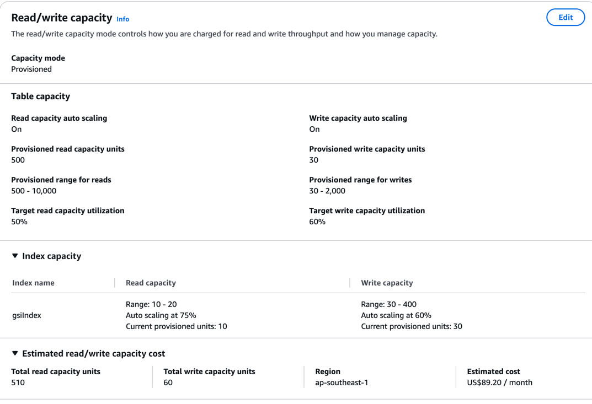
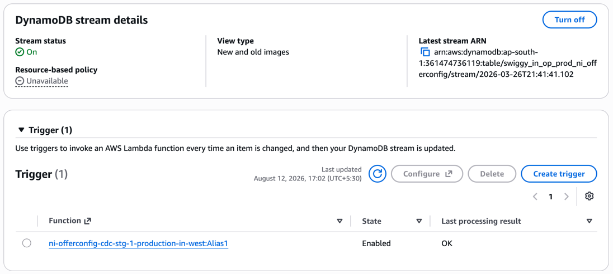
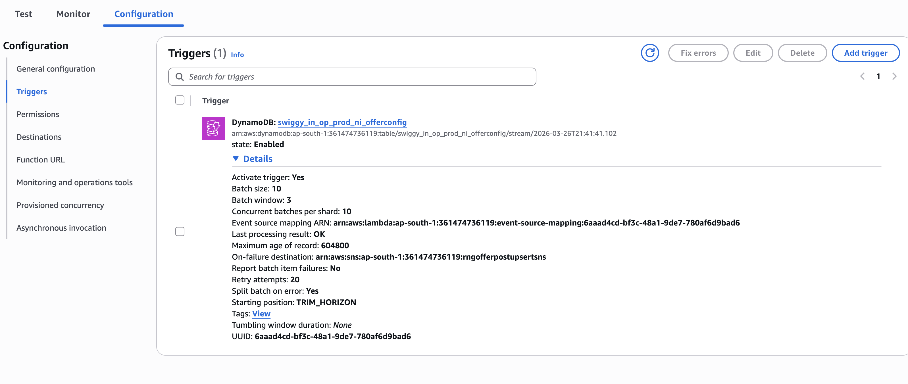

# DynamoDB Deep Dive



## Step 1 → RCU and WCU

### 1. What is RCU and WCU

- **RCU (Read Capacity Unit)** — 1 RCU = 1 strongly consistent read/sec for an item up to 4KB.
- **WCU (Write Capacity Unit)** — 1 WCU = 1 write/sec for an item up to 1KB.

> Think of RCU/WCU as a **speed limit dial**, not a bucket of requests. You pay for how fast you can read/write per second — not how much data you store.

**What "item size" means**

Size of the actual item (row) — sum of all attributes (partition key, sort key, every column) — in bytes as stored, not as it looks in JSON.

**Formula**

```
RCU needed = ceil(item_size_in_KB / 4)   [strongly consistent read]
WCU needed = ceil(item_size_in_KB / 1)
```

| Item size | Read (strong) | Read (eventual) | Write |
|---|---|---|---|
| 2 KB | 1 RCU | 1 RCU (2KB fits in 4KB → still 1) | 2 WCU |
| 4 KB | 1 RCU | 1 RCU | 4 WCU |
| 4.1 KB | 2 RCU (rounds up) | 1 RCU | 5 WCU |
| 10 KB | 3 RCU | 2 RCU | 10 WCU |

> Bigger item → more units needed. It always **rounds up** to the next whole unit.

---

### 2. Real time — per second, every second

Provisioned capacity is **not a daily quota**. It's a ceiling checked fresh every single second.

- **Second 1:** 40 reads of 4KB items → consumed 40/50 RCU. Fine.
- **Second 2:** 60 reads → consumed 60/50 RCU → extra 10 either:
  - burn **burst capacity** (unused RCU saved from last 5 min, like a rolling credit), or
  - get **throttled** → fails with `ProvisionedThroughputExceededException`, client must retry.
- **Second 3:** back to 30 reads → consumed 30/50. Fine again.

---

### 3. Strongly consistent vs Eventually consistent

- **Strongly consistent** — you always get the **latest** written value. Full price: 1 RCU per 4KB.
- **Eventually consistent** — you might get slightly **stale** data (replica hasn't caught up yet, usually within ~1 sec). Half price: 0.5 RCU per 4KB.

| Read type | Cost per 4KB chunk |
|---|---|
| Strongly consistent | 1 RCU |
| Eventually consistent | 0.5 RCU (2 reads for 1 RCU) |

> Set per request via `ConsistentRead: true/false` in the API call — not a table setting. Default is **false** (eventual).
> **GSI reads are always eventually consistent** — `ConsistentRead: true` is not allowed on a GSI.

**Same table, same query — what's actually different**

DynamoDB keeps each item copied across multiple replicas (different AZs). A write lands on a majority first, then syncs to the rest — that sync isn't instant.

- **Strong read** → always routed to the replica with the latest write. Guaranteed fresh, every time.
- **Eventual read** → routed to *any* replica, might be one that hasn't synced yet. Usually catches up within ~1 sec (often ms), but not guaranteed on that exact read.

```
T=0ms   Write: user.status = "active"
T=5ms   Strong read   → "active"              ✅ always correct
T=5ms   Eventual read → could be old value    ⚠️ replica may not have synced yet
T=50ms  Eventual read → "active"               ✅ caught up by now
```

Rule of thumb: use **strong** for write-then-read-your-own-write flows (e.g. user updates profile, reloads immediately). Use **eventual** for dashboards/analytics/background jobs — cheaper, faster, staleness doesn't matter.

---

### 4. Throttling — example scenario

**Setup:** Provisioned RCU = 30. You send **50 strongly consistent reads** (1 RCU each, ≤4KB items) in the same second.

1. First **30 requests** → allowed, consume the full 30 RCU. ✅
2. Remaining **20 requests** → exceed the ceiling. DynamoDB checks for **burst capacity** (unused RCU banked from the last ~5 min, if you weren't using the full 30 RCU/sec consistently):
   - **Burst available** → covers the 20, they succeed too. ✅
   - **Burst exhausted** (e.g. you've been running near 30 RCU steadily) → the 20 requests are **throttled**, fail instantly with `ProvisionedThroughputExceededException`. ❌

**What happens next:**
- Throttling is an instant rejection, not a queue.
- AWS SDK **auto-retries with exponential backoff** by default — often invisible to your app.
- If retries also exhaust → exception bubbles up to your code, must be handled explicitly.
- If **auto scaling** is on: it reacts to sustained overload via a CloudWatch alarm, but takes **~1-2 minutes** to raise capacity — so the *first* burst still throttles; only sustained load gets fixed automatically.

> Provisioned capacity is a hard per-second ceiling. Exceeding it either eats banked burst capacity or throttles the excess — auto scaling helps with sustained load, not instant spikes.

---

### 5. Same applies for writes (WCU)

Identical mechanics as reads — just no strong/eventual split (writes are always full price, no "eventual write").

**Setup:** Provisioned WCU = 30. You send **50 writes** (1 WCU each, ≤1KB items) in the same second.

1. First **30 writes** → succeed, consume full 30 WCU. ✅
2. Remaining **20 writes** → check burst capacity:
   - Burst available → covered, succeed. ✅
   - Burst exhausted → throttled → `ProvisionedThroughputExceededException`. ❌
3. SDK auto-retries with backoff. Auto scaling reacts in ~1-2 min for sustained load, not the instant spike.

**Write-specific notes:**
- **Transactional writes cost 2x WCU** (same as transactional reads cost 2x RCU) — extra coordination for all-or-nothing across multiple items.
- **BatchWriteItem / BatchGetItem** consume RCU/WCU summed across all items in the batch. If an individual item gets throttled, it comes back in `UnprocessedItems` for retry — the whole batch doesn't fail.

## Step 2 → What is Provisioned range means?

Refers to the screenshot's **"Provisioned range for reads: 500 – 10,000"** and **"Provisioned range for writes: 30 – 2,000"**.

These are the **min/max boundaries for auto-scaling** — the floor and ceiling within which DynamoDB is allowed to move provisioned RCU/WCU automatically.

- **Min (e.g. 500 for reads)** → DynamoDB never scales *down* below this, even at near-zero traffic. You always pay for at least this much.
- **Max (e.g. 10,000 for reads)** → DynamoDB never scales *up* beyond this, no matter how much traffic spikes. This is your **cost safety cap**.

**How it connects to the auto-scaling target (50% in the screenshot):**
- Auto-scaling watches actual consumed RCU.
- Consumption climbs above target % → raises provisioned RCU, capped at max.
- Consumption drops below target % → lowers provisioned RCU, floored at min.

**Example:**
```
Current provisioned: 500 RCU (min)
Traffic spikes → consumed RCU regularly ~350 (70% of 500, above 50% target)
Auto-scaling raises provisioned RCU → say to 700
Traffic keeps growing → keeps raising... but stops hard at 10,000 (max)
```

**Why a range instead of a fixed number:**
- Max protects against **runaway cost** (bug/spike doesn't silently balloon the bill).
- Min protects against **under-provisioning at idle** (baseline capacity so sudden traffic isn't throttled while scaling catches up).

> If real traffic needs more than the max, it gets throttled like any other capacity-exceeded case — the range doesn't auto-expand, the max must be raised manually.

**Auto-scaling isn't instant**

- CloudWatch needs a **sustained breach** (~1-2 min of consecutive data points above target) before it fires the scale-up alarm. Then scaling takes effect — the whole loop is usually **1–3 minutes**, not seconds.
- ✅ **Gradual/sustained traffic growth** → auto-scaling reacts well before hitting the max ceiling, since target (50%) leaves headroom below 100%.
- ❌ **Sudden spikes** (e.g. load jumping in the same second) → auto-scaling does **not** react fast enough; that immediate burst still throttles. Scaling only helps once load persists long enough for CloudWatch to notice.

> Target tracking auto-scaling protects against **sustained load growth**, not **instant spikes**.

## Step 3 -> What is Target [Read/Write] Capacity Utilization

The 50% (reads) / 60% (writes) value from the screenshot — the trigger threshold auto-scaling uses to decide when to scale up or down.

```
Utilization % = (consumed RCU / provisioned RCU) × 100
```

With provisioned = 500 and target = 50%:
- Auto-scaling tries to keep consumed RCU hovering around **250** (50% of 500).
- Consumed RCU rises above 250, sustained → scale **up** provisioned RCU.
- Consumed RCU drops below 250, sustained → scale **down** provisioned RCU (saves cost).

**Why not target 100%?**
- Target = 100% → zero buffer, any tiny spike instantly throttles (no room, no reaction time).
- Lower target (e.g. 50%) → more headroom, safer, but pay for unused capacity more often.
- Higher target (e.g. 80–90%) → less waste, but riskier — less buffer while scaling reacts.

> Target % is a **cost vs safety-margin dial**. Low target = expensive but spike-safe. High target = cheap but riskier. AWS's suggested default is **70%**; this table uses 50% (reads, conservative) and 60% (writes).

## Step 4 → What is GSI and why we need it

### 1. What is GSI

- **GSI = Global Secondary Index.**
- An alternate way to query your table using a **different key**, without changing the original table.
- You can only efficiently query by the base table's partition/sort key — anything else needs a `Scan` (slow, reads every item). A GSI fixes that.

**Example:** table `Orders`, PK = `orderId`.
- "Get order by orderId" ✅ fast (base table).
- "Get all orders by userId" ❌ needs full scan — unless you add a GSI with PK = `userId`. Then it's fast too.

### 2. How you create one

- **You pick the index name** (e.g. `userId-index`, `gsiIndex`) — your choice.
- **You pick the GSI partition key** (e.g. `userId`), optionally a sort key too (e.g. `createdAt`).
- It's **not a separate table** — just an index attached to the same table. Query it via `TableName` + `IndexName`.
- **You pick the projection** — which columns get copied into the GSI (`ALL`, `KEYS_ONLY`, or a subset) — saves storage if you don't need every column there.

### 3. Index capacity is separate

- Each GSI has its **own RCU/WCU pool**, independent of the base table's capacity.
- Think of a GSI as its own mini-table, auto-synced by DynamoDB, so it needs its own throughput.

### 4. Writes cascade into GSIs

- Writing an item to the base table **also writes to every GSI** whose key attributes that item touches.
- That GSI write consumes **the GSI's own WCU**, not the base table's.
- **Gotcha:** if a GSI's WCU is too low, base table writes can get throttled — even if the base table itself has plenty of capacity.

## Step 5 → Provisioned unit vs Consumed unit (Monitor graph)

### 1. What each line means

- **Provisioned** — the capacity ceiling right now. Staircase-shaped — flat, jumps only when auto-scaling changes it.
- **Consumed** — actual RCU/WCU your traffic used. Jagged — moves with real request volume.

### 2. How to read it

```
RCU
 │
50├─── Provisioned (flat line — your ceiling)
 │        ╭╮        ╭─╮
30├───   ╱  ╲  ╱╲  ╱   ╲     ← Consumed (jagged — actual usage)
 │      ╱    ╲╱  ╲╱
 0└──────────────────────────→ time
```

- Consumed line stays below Provisioned line → healthy, no throttling.
- Consumed line touches/crosses Provisioned line → **throttling** (often shown as a `ThrottledRequests` spike exactly there).
- Consumed way below Provisioned → over-provisioned, wasting money.
- Consumed keeps spiking near Provisioned → under-provisioned, raise capacity/target or check for a hot partition.

### 3. Example — Provisioned = 500, Target = 50%

```
Consumed ≤ 250       → Provisioned line stays flat at 500
Consumed > 250 (sustained ~1-2 min) → Provisioned steps up (e.g. 500 → 700)
                        → new trigger becomes 50% of 700 = 350
Consumed drops        → scales back down, never below min
```

```
RCU
 700├────────────────────╭──────  ← Provisioned steps up
    │                    │
 500├───────╮  ╭╮        │
    │        ╲╱  ╲   ╭───╯
 250│ - - - - - - -╲-╱- - - - -  ← trigger line (50% of current provisioned)
    │   consumed
   0└──────────────────────────→ time
```

> Trigger point isn't fixed — it's always "target % of *current* Provisioned," so it moves up each time Provisioned steps up.

---

## Deep Understand — What all need to cover

| Topic | Why it matters in interviews |
|---|---|
| **Partition key design & hot partitions** | THE most-asked DDB interview topic. How partitioning works internally, why bad key choice kills throughput even with high provisioned capacity. |
| **On-Demand vs Provisioned** | Trade-offs, when to pick which. |
| **Single-table design** | Signature DynamoDB interview topic — modeling multiple entity types in one table, adjacency list pattern, overloaded GSIs. |
| **LSI vs GSI** | Deeper comparison — creation-time-only, shared capacity, strong consistency support. |
| **DynamoDB Streams** | Change data capture, used with Lambda for event-driven architectures. |
| **Transactions (TransactWriteItems/TransactGetItems)** | ACID across items, 2x cost, when to use vs conditional writes. |
| **Conditional writes / optimistic locking** | Handling concurrent updates without transactions. |
| **Global Tables** | Multi-region replication — multi-region design questions. |
| **TTL, backups (PITR), DAX (caching layer)** | Common follow-up/curveball topics. |
| **Query vs Scan, pagination, filter expressions** | Efficient access pattern fundamentals. |
| **Partition limits** — 3000 RCU / 1000 WCU / 10GB per partition | Ties back to hot partitions — the "aha" depth interviewers look for. |

---

##  THROTTLING:

**When throttling happens:** whenever requests in a given second exceed available capacity (provisioned ceiling + any banked burst) — can happen even if the **table-level** average looks fine, because DynamoDB enforces limits **per partition**, not just per table.

**Impact:** throttled requests fail immediately with `ProvisionedThroughputExceededException` — no data read/written for that request. Unhandled, this shows up as increased latency (SDK retries/backoff), degraded UX, or outright errors once retries exhaust. Often the root cause of "mysterious" perf issues — table looks fine in aggregate, but one hot key is getting hammered.

**What happens to the request when throttled**

| API type | On throttle |
|---|---|
| Single-item (GetItem, PutItem, Query, UpdateItem, DeleteItem) | Exception thrown (`ProvisionedThroughputExceededException`) → SDK auto-retries with exponential backoff by default |
| Batch (BatchGetItem, BatchWriteItem) | No exception for the whole batch — throttled items returned as `UnprocessedItems` (write) / `UnprocessedKeys` (read) → caller must resubmit them |

> Blindly assuming a `BatchWriteItem`/`BatchGetItem` call fully succeeded is a common bug — always check `UnprocessedItems`/`UnprocessedKeys` isn't empty and retry-loop it.

**How to avoid Write throttle**

1. **Rate Limiting (proactive)** — cap your OWN write rate before DDB ever sees it, instead of firing full speed and reacting to failures.
   - Token bucket: bucket = your WCU (e.g. 30), refills every second. No token → request waits. You physically can't exceed the cap.
   - Remember as: **"don't send more than you're allowed, ever."**

2. **Backpressure (reactive)** — a feedback loop: when DDB signals it's struggling (throttle errors rising), the producer dynamically slows down instead of continuing at the same rate.
   - Pattern: put a **queue** (e.g. SQS) between producer and DDB. Consumer pulls slower when throttling rises, faster when it clears.
   - AIMD (like TCP): ramp rate up slowly when healthy, cut sharply the moment throttling appears.
   - Retries use **exponential backoff + jitter** — avoids a retry storm making throttling worse.
   - Remember as: **"listen to the system, slow down when it complains."**

   **How do we know throttle happened? — 3 signals:**
   - **Exception** — single-item calls (GetItem/PutItem/Query) throw `ProvisionedThroughputExceededException` directly.
   - **Unprocessed list** — batch calls (BatchWriteItem/BatchGetItem) don't throw; check if `UnprocessedItems`/`UnprocessedKeys` is non-empty.
   - **CloudWatch metric** — `WriteThrottleEvents`/`ReadThrottleEvents`, useful for system-wide monitoring, not per-request code.

   **How the signal feeds the backpressure loop:**
   ```
   Track each write: success or throttled, in a sliding window (e.g. last 5 sec / last 100 requests)

   throttle_rate = throttled_count / total_count

   throttle_rate rising → slow down (consumer pulls slower from queue)
   throttle_rate == 0   → speed back up gradually (AIMD)
   ```

   > Simple version: the signal is whatever DDB tells you failed — exception (single-item), unprocessed list (batch), or CloudWatch metric (system-wide). Feed whichever one you have into a rolling throttle-rate counter, and use that number to speed up or slow down.

**Worked example — Provisioned WCU = 30, window = last 5 seconds**

| Second | Writes sent | Succeeded (cap 30) | Throttled | throttle_rate this sec |
|---|---|---|---|---|
| 1 | 25 | 25 | 0 | 0/25 = 0% |
| 2 | 35 | 30 | 5 | 5/35 = 14% |
| 3 | 40 | 30 | 10 | 10/40 = 25% |

```
Sliding window (last 3 sec) = 25+35+40 = 100 sent, 0+5+10 = 15 throttled
throttle_rate = 15 / 100 = 15%   → rising → BACK OFF
```

**Backpressure reacts:** consumer cuts send rate (e.g. 40/sec → 20/sec, below the 30 WCU cap so queue drains safely).

| Second | Writes sent | Succeeded | Throttled | throttle_rate this sec |
|---|---|---|---|---|
| 4 | 20 | 20 | 0 | 0% |
| 5 | 20 | 20 | 0 | 0% |

```
New window (sec 3-5) = 40+20+20 = 80 sent, 10+0+0 = 10 throttled
throttle_rate = 10/80 = 12.5%   → still positive but falling → hold or ease up slightly
```

Once throttle_rate hits **0% for a couple consecutive windows** → AIMD ramps send rate back up gradually (e.g. 20 → 25 → 30/sec), watching throttle_rate again at each step. If it spikes again → cut hard (e.g. back to 15/sec) and repeat.

> That's the whole loop: **measure → compute rate → back off if rising, creep up if zero → repeat.**

> Rate limiting = static cap set upfront (known capacity). Backpressure = dynamic adjustment based on real-time signal (changing conditions). Use both: rate limiter as the floor, backpressure as the live correction on top.

**How to avoid Read throttle**

Same two flow-control solutions as writes, plus one read-specific lever:

1. **Rate Limiting** — cap read requests at/under known RCU, upfront. Same token-bucket idea.
2. **Backpressure** — watch throttle signal (exception / CloudWatch `ReadThrottleEvents`), dynamically slow down consumer, ramp back up when clear (AIMD).
3. **Use eventually consistent reads instead of strongly consistent** — halves RCU cost per read (0.5 RCU vs 1 RCU per 4KB), so the same rate ceiling now handles 2x the actual request volume before throttling.

> Rate limiting + backpressure = universal safety net for any throttling, read or write. Eventual consistency is a read-only extra lever — it reduces cost per request, not just the send rate.

---

## Partition Key Design & Hot Partitions

### 1. What a "partition" actually is

DynamoDB doesn't store your table as one giant blob. Internally, it's split into multiple **physical storage partitions** — each a self-contained chunk of SSD storage with its own fixed throughput ceiling. Many small independent shards behind the scenes, stitched together to look like one table.

### 2. How DynamoDB decides which partition an item goes to

Every partition key value gets run through an **internal hash function**. The hash output determines exactly which physical partition that item lands on.

```
PutItem(orderId = "ORD123")
   ↓
hash("ORD123") → some hash value
   ↓
hash value maps to Partition #7 (deterministic, always same partition for same key)
```

Items with the **same partition key** always land on the **same physical partition** (required — Query needs them co-located). Items with **different** keys spread across different partitions, ideally evenly, if the hash distributes well.

### 3. Hard limits — per partition, not per table

| Limit | Value |
|---|---|
| Max throughput per partition | **3000 RCU** and/or **1000 WCU** |
| Max storage per partition | **10 GB** |

Table-level provisioned capacity (say, 10,000 RCU) is **not one shared pool** — DynamoDB divides it across all partitions. **A single partition can never exceed 3000 RCU / 1000 WCU**, no matter how much you've provisioned at the table level.

### 4. What a "hot partition" is

One partition receiving disproportionately more traffic than others, because too many requests hash to the same partition key (or a small handful of keys).

| Bad pattern | Why it creates a hot partition |
|---|---|
| **Low cardinality key** — e.g. `status` as PK | Only 2-3 hash values → all traffic funnels into 2-3 partitions. |
| **Time-based key** — e.g. `date` as PK | Everyone writing "today's" data hits the SAME partition all day. |
| **Celebrity/whale problem** — e.g. `userId` as PK, one user gets 1000x traffic | That one partition gets slammed while millions of others idle. |
| **Sequential/incrementing keys** — e.g. auto-increment order IDs | New writes always land on the "latest" partition range — moving hot spot. |

### 5. The impact — why this is the "aha" interview moment

Table-level dashboard can look **totally healthy** while one partition throttles constantly:

```
Table-level view (looks fine):     Reality (per-partition):
Provisioned: 40,000 RCU            Partition 1: 3000/3000 RCU  ← THROTTLING
Consumed:     3,000 RCU  (7.5%)    Partition 2:    5/3000 RCU  (idle)
                                    Partition 3:    3/3000 RCU  (idle)
```

**Raising table-level provisioned capacity does NOT fix this** — a hot partition is still capped at 3000 RCU regardless of table total. Result: throttling, retries, cascading latency, degraded UX for a slice of traffic while dashboards suggest plenty of headroom.

### 6. Solutions — what production code actually does

**Priority order — good key design first, salting is last resort:**

**a) Good key design upfront (highest ROI — prevents the problem entirely)**

A good key needs: high cardinality + uniform traffic + matches the access pattern. Deciding PK vs SK:

- **PK (Partition Key)** → the field that spreads data/traffic evenly across partitions. Pick the entity with many distinct, evenly-used values (e.g. `userId`, `tenantId#userId`).
- **SK (Sort Key)** → the field that lets you range-query / sort **within** one partition key's items. Same PK, many SK values, all co-located.

Example — `Orders` table:
```
PK = userId          SK = orderId
─────────────────────────────────
userId=U1   orderId=O1   {amount: 200, date: ...}
userId=U1   orderId=O2   {amount: 450, date: ...}
userId=U2   orderId=O3   {amount: 100, date: ...}
```
- `userId` as PK → high cardinality (millions of users), spreads writes/reads across partitions.
- `orderId` as SK → lets you fetch "all orders for U1" as one fast Query (range within the U1 partition), while each order stays uniquely identifiable.

**b) Cache + single-flight (the actual go-to fix for hot READS)**
- Put DAX or Redis in front of DynamoDB — absorbs repeated reads for the same hot key before they ever reach DDB.
- Combine with **single-flight / request coalescing** — if 100 concurrent requests miss cache for the same key at once, only 1 goes to DDB; the other 99 wait and share that result.
- This is what most companies actually reach for — simpler than salting, solves the vast majority of real hot-key incidents.

**c) Read/write salting — rarely used in practice**
- Append a random suffix to spread a hot key across multiple physical partitions (duplicate data for read-hot, split data for write-hot — see earlier example).
- Reserved for extreme cases caching can't solve (e.g. a real-time counter under massive concurrent write load). Most teams never need to implement this — it's a last-resort, high-complexity fix.

> **Interview soundbite:** *"DynamoDB divides table-level provisioned capacity across physical partitions, each hard-capped at 3000 RCU / 1000 WCU / 10GB. A poorly chosen partition key funnels disproportionate traffic into one partition, throttling even when the table's aggregate utilization looks low. In production, the real fix is good key design (high cardinality PK, SK for range queries) plus a cache with single-flight in front of hot reads — salting is a last resort for extreme write-hot keys that can't be cached away."*

### Celebrity / whale problem — read vs write fix

Key design is fine here (e.g. `userId` has high cardinality) — the issue is real-world traffic skewed toward ONE value. Different fix for reads vs writes:

| Side | Problem | Fix |
|---|---|---|
| **Read** (everyone reading the same hot item) | Stampede of identical reads | **Cache + single-flight** — only 1 request hits DDB, rest wait/share the result |
| **Write** (everyone writing distinct events, e.g. likes) | Flood of unique writes, can't be coalesced | **Buffer + batch write** — aggregate events in memory/queue (e.g. Kinesis/SQS) for ~1 sec, flush ONE combined update instead of writing every event |

```
Single-flight (read):  1M identical reads → 1 DDB read, rest share result
Buffer+batch (write):  1M distinct likes  → aggregate for 1 sec → 1 DDB write ("+50,000")
```

> Single-flight coalesces **duplicate** requests (reads). It can't help writes because each write is unique data — that needs aggregation instead.

---

## DynamoDB Streams

**What is CDC:** Change Data Capture — every insert/update/delete on the table automatically gets recorded as an ordered event, like a change log (similar to a DB's WAL/binlog). We use it to react to data changes async (e.g. sync a lookup table) without the app manually publishing events.

### Shard & order guarantee — simple example

Shard = **one ordered lane**. Table `Orders`, PK=`userId`, 5 writes: `U1 create → U2 create → U1 update → U3 create → U1 delete`.

```
Shard A (U1, U3): [INSERT U1] → [MODIFY U1] → [INSERT U3] → [REMOVE U1]   ← order preserved
Shard B (U2):     [INSERT U2]
```

Same key → always same shard → order guaranteed. Different keys → may land in different shards → no order guarantee between them (but can run in parallel). **You never manage this — DDB handles shard routing automatically.**

### Deep dive

1. **What it is** — every write generates a stream record: `{eventName: INSERT/MODIFY/REMOVE, keys, newImage}`.

2. **Shards** — internally identical concept to Kinesis. Ordering only guaranteed *within* a shard, which maps to a subset of partition keys.

3. **StreamViewType** — controls what's in each record:

   | Type | What you get |
   |---|---|
   | `KEYS_ONLY` | Just the key attributes |
   | `NEW_IMAGE` | Item after the change |
   | `OLD_IMAGE` | Item before the change |
   | `NEW_AND_OLD_IMAGES` | Both — needed to diff what changed |

4. **Lambda consumption (Event Source Mapping)** — polls each shard, batches records, invokes your function **once per batch** (array of records, not one event).

5. **Failure handling — the important gotcha** — if Lambda errors on a batch, it retries the SAME batch and **blocks that shard** from advancing until it succeeds or retries exhaust.
   ```
   Batch fails → retry same batch → still failing → shard STUCK
      ↓
   New changes for that shard's keys pile up unprocessed
      ↓
   CloudWatch "IteratorAge" metric grows — your lag indicator
   ```
   Mitigate with `bisectBatchOnFunctionError`, an on-failure DLQ destination, and idempotent consumer logic (retries can redeliver the same record).

6. **Retention** — 24 hours default (up to 7 days extended). If a stuck shard isn't fixed in time, those events are gone — needs manual reconciliation.

### Interviewer follow-up: "Stream data isn't flowing — how do you debug?"

Check in this order — cheapest/most upstream first:

1. **Is data actually being written to the table?** (rules out "nothing to stream in the first place")
2. **Is Streams enabled on the table?** (rules out "no stream even exists")
3. **Is the Lambda ESM enabled/attached?** (rules out "wiring between stream and Lambda is off")
4. **Check `IteratorAge` (CloudWatch)** — tells you whether the problem is upstream (steps 1-3, nothing flowing at all) or downstream (ESM fine, but Lambda stuck/erroring on a batch — check Lambda logs/errors next).

**What is ESM (Event Source Mapping)?**

The glue/connector AWS creates between your Lambda and the stream — it's what polls the shards and invokes Lambda. Without it, Lambda has no idea the stream exists.

```
DynamoDB Stream  ←——— ESM ———→  Lambda function
   (the data)      (the wiring)     (your code)
```

- Created when you wire "trigger this Lambda from this Stream" (console/CLI/IaC).
- A separate AWS resource with its own state (`Enabled`/`Disabled`) and settings (batch size, retry config, DLQ, `bisectBatchOnFunctionError`).
- It can end up `Disabled` — manually, or auto-disabled by AWS after repeated failures — meaning Lambda's code is fine but nothing is even calling it.

### How to actually check this in AWS console

**1. DynamoDB → table → Exports and streams tab**



- **Stream status: On** → confirms Streams is enabled on the table (checklist step 2).
- **View type: New and old images** → confirms which `StreamViewType` is set (what data each record carries).
- **Trigger → Function** → shows exactly which Lambda is wired to consume this stream.
- **Trigger → State: Enabled** → confirms the ESM is active, not disabled (checklist step 3).
- **Last processing result: OK** → tells you the last batch Lambda processed succeeded — if this said something else (e.g. an error), that's your smoking gun.

**2. Lambda → function → Configuration → Triggers**



- **state: Enabled** → same ESM enabled check, from the Lambda side.
- **Batch size / Batch window** → how many records (or how long) it waits before invoking your function per batch.
- **Concurrent batches per shard** → how many batches from the same shard can process in parallel (affects throughput vs ordering trade-off).
- **Event source mapping ARN / UUID** → the ESM's unique resource ID — useful when checking its status via CLI.
- **Last processing result: OK** → confirms this specific ESM's last batch succeeded.
- **Maximum age of record: 604800** → this is your retention/max-record-age setting in seconds (7 days here) — how long a record can wait before being discarded.
- **On-failure destination: arn:...sns:...** → where failed batches go after retries exhaust (their DLQ/SNS topic) — check this if you suspect silent failures.
- **Retry attempts: 20** → how many times a failing batch is retried before going to the failure destination.
- **Split batch on error: Yes** → `bisectBatchOnFunctionError` is on — a bad record won't block the whole batch forever, it gets isolated.
- **Starting position: TRIM_HORIZON** → new ESMs start reading from the oldest available record in the stream, not just new ones.

### Interviewer follow-up: "A burst of writes hits the table — does Lambda get bombarded and miss processing?"

> *"DynamoDB Streams + Lambda is a pull-based, auto-scaling consumer, not a push model — a write burst doesn't overwhelm Lambda by flooding it; the ESM scales concurrency per shard (and via Parallelization Factor, even within a shard) to keep pace. The only real limit is Lambda's account concurrency ceiling — if hit, processing just lags temporarily (visible as rising IteratorAge) and catches up once the burst passes, with no data loss as long as it's within the retention window."*

---

## Conditional Writes / Optimistic Locking

### 1. The problem — Lost Update

```
Item: {productId: "P1", stock: 10}

Client A reads stock=10 (wants to sell 2 → set stock=8)
Client B reads stock=10 (wants to sell 3 → set stock=7)

A writes: stock=8
B writes: stock=7   ← overwrites A's update, A's sale is silently lost!
Correct answer should've been 10-2-3=5, got 7 instead.
```
DynamoDB has no locking (no `SELECT FOR UPDATE`) — "read → compute → write" isn't atomic by default, so concurrent writers can clobber each other.

### 2. Conditional Writes — the fix, atomically

Every write API (`PutItem`/`UpdateItem`/`DeleteItem`) supports `ConditionExpression`: "only perform this write IF this is true — else fail." Checked and written **in one atomic server-side call**, no race window.
```
UpdateItem(key=P1, update="SET stock = stock - 2", condition="stock >= 2")
```
Fails with `ConditionalCheckFailedException` if condition doesn't hold — nothing is written.

### 3. Optimistic Locking — version attribute pattern

Add a `version` field. Every write checks version hasn't changed, and bumps it.
```
A: UpdateItem SET stock=8,version=4 WHERE version=3   ✅ (DB still had version 3)
B: UpdateItem SET stock=7,version=4 WHERE version=3   ❌ FAILS (DB is now version 4)
B re-reads (stock=8,version=4), retries: SET stock=5,version=5 WHERE version=4   ✅ correct!
```
"Optimistic" = no lock held upfront — assume conflicts are rare, detect + retry only when they happen.

### 4. How this looks in production code

**Never do a separate check-then-write** — that reintroduces the race. Instead, attach the expected version as the `ConditionExpression` on the SAME write call:
```
loop (up to N retries):
  item = GetItem(id)                     // read current state
  newStock = item.stock - qty

  try:
    UpdateItem(
      update    = "SET stock=:s, version=:v",
      condition = "version=:expected",
      values    = { s: newStock, v: item.version+1, expected: item.version }
    )
    return SUCCESS
  catch ConditionalCheckFailedException:
    continue   // someone else updated it — re-read and retry
```
DynamoDB checks the version AND writes in **one atomic request** — either both happen or neither does. Your app's only job is to catch the failure and retry the loop.

---

## LSI vs GSI

**LSI = Local Secondary Index.** **GSI = Global Secondary Index.**

**Simple core difference:** LSI shares the base table's partition key. GSI can use a completely different partition key.

| | LSI | GSI |
|---|---|---|
| Partition key | Same as base table (can't change) | Can be any attribute |
| Sort key | Different from base table's sort key | Can be any attribute |
| When created | Only at table creation time — can't add later | Anytime — add/remove whenever |
| Capacity | Shares the base table's RCU/WCU | Has its own separate RCU/WCU pool |
| Consistency | Supports strong or eventual reads | Eventual only — no strong consistency option |
| Storage limit | 10GB per partition key value across base table + all LSIs combined | No such combined limit |
| Max count | 5 per table | 20 per table (default) |

**Simplest way to remember it:**
- **LSI** = "same partition, different sort order" — e.g. base table PK=`userId`, SK=`orderDate`; LSI gives you PK=`userId`, SK=`orderAmount` instead — same user's data, just sorted/filtered differently.
- **GSI** = "a whole different way to slice the table" — e.g. base table PK=`orderId`; GSI gives you PK=`userId` — totally different access pattern, like Step 4.

### Why we need it / when we use it

**1. You need STRONG consistency on an alternate sort order (the big one)**

GSI can never give you strongly consistent reads — only eventual. If your access pattern needs the freshest possible data on a secondary sort/filter, LSI is your only option (besides querying the base table directly).

```
Orders table: PK = userId, SK = orderDate   (base table)

You also need: "get this user's orders sorted by amount" — WITH strong consistency,
because right after a user places an order, they view their order list and it
must reflect that order immediately (financial/inventory context — staleness unacceptable).

→ LSI: PK = userId, SK = amount, ConsistentRead: true   ✅ works
→ GSI: PK = userId, SK = amount, ConsistentRead: true   ❌ not allowed, GSI is eventual-only
```

**2. No extra capacity cost — shares the base table's RCU/WCU**

A GSI needs its own provisioned/on-demand capacity — separate scaling, separate monitoring, separate cost, and its own throttling risk if under-provisioned (Step 4). An LSI shares the base table's throughput pool — no separate capacity planning, no separate bill line, one less thing to monitor/tune.

---

## Single-Table Design

### 1. What it is

Instead of a separate table per entity (Users, Orders, OrderItems), put **all entity types into ONE table**, using generic `PK`/`SK` names and a `Type` attribute to tell items apart.

### 2. Why it's needed

**DynamoDB has no JOIN.** With separate tables, fetching related data needs multiple round trips:
```
GetItem(Users, userId) → Query(Orders, userId) → Query(OrderItems, orderId) × N orders
= N+1 round trips just to render one page
```
Single-table design "pre-joins" data at write time by co-locating related items under the same partition key, so **one Query fetches everything.**

### 3. The pattern — Adjacency List, with example

```
PK              SK              Type        Data
──────────────────────────────────────────────────────────
USER#123        PROFILE#123     USER        {name, email}
USER#123        ORDER#456       ORDER       {orderDate, total: 200}
USER#123        ORDER#789       ORDER       {orderDate, total: 450}
ORDER#456       ITEM#001        ORDERITEM   {productId: P1, qty: 2}
PRODUCT#P1      METADATA        PRODUCT     {name: "Shoe", price: 50}
```
```
Query(PK = "USER#123") → returns PROFILE#123, ORDER#456, ORDER#789 — ALL in ONE call
```

### 4. PK can repeat — with a Sort Key, uniqueness is PK+SK together

- Table with **only** a partition key → PK must be unique, no duplicates.
- Table with **PK + SK** (composite key) → PK CAN repeat, as long as SK differs each time. Uniqueness is on the **(PK, SK) pair**, not PK alone.
- This is exactly why single-table design works above — `PK="USER#123"` repeats 3 times, distinguished by different `SK` values.

### 5. Trade-offs

- Must know **all access patterns upfront** — unlike SQL, can't just add a new JOIN later.
- Generic `PK`/`SK` aren't self-documenting — needs a clear entity chart/docs.
- Not a fit for ad-hoc/analytical queries — those belong in a separate OLAP store (e.g. via Streams → Redshift/S3).

> **Interview soundbite:** *"DynamoDB has no JOIN, so single-table design co-locates related entities under the same partition key (adjacency list pattern) using generic PK/SK and a type attribute, so one Query replaces N+1 round trips. It only works because a composite key's uniqueness is PK+SK together, not PK alone — the trade-off is you must know your access patterns upfront and document the schema well since generic keys aren't self-describing."*

---

## Transactions (TransactWriteItems)

### 1. Simple definition

Groups **up to 100 write operations** (Put/Update/Delete/ConditionCheck), across one or more tables, into a single **all-or-nothing** unit — either every operation succeeds, or none do.

### 2. Use of it — example

Conditional writes (Step 9) only protect **one item**. Transactions are for when **multiple items must change together**:
```
Transfer $100 from Account A to Account B:

TransactWriteItems([
  { Update: A, expr: "SET balance = balance - 100", condition: "balance >= 100" },
  { Update: B, expr: "SET balance = balance + 100" }
])

→ Both succeed together, or both roll back. Never a half-done state (money never "vanishes").
```
Costs **2x WCU** — extra internal coordination (prepare + commit) to guarantee atomicity.

### 3. Transactions vs Batch

| | `BatchWriteItem` | `TransactWriteItems` |
|---|---|---|
| Atomicity | NOT atomic — partial success possible, failed items in `UnprocessedItems` | Fully atomic — all succeed or all fail |
| Cost | Normal cost | 2x cost |
| Use case | Write independent items efficiently | Items MUST change together or not at all |

### 4. Transactions vs Conditional Write / Optimistic Locking

| | Conditional Write | Transaction |
|---|---|---|
| Scope | 1 item | Up to 100 items |
| Cost | Normal | 2x |
| Use case | Prevent concurrent overwrite on ONE item | Atomicity across MULTIPLE items |

> Default to conditional writes for single-item concurrency (cheaper). Use transactions only when the business logic genuinely needs multiple items to change atomically together.

---

## On-Demand vs Provisioned

### 1. What each is

- **Provisioned** — you (or auto-scaling) set RCU/WCU ahead of time. Reserved, billed whether used or not, throttles beyond the ceiling.
- **On-Demand** — no capacity set. DynamoDB auto-scales to whatever traffic arrives, billed **per request actually made**.

**Provisioned — example:**
```
You set: 100 RCU provisioned, all day, every day

Day 1: app uses 100 RCU at peak, 10 RCU overnight
       → you still PAY for 100 RCU the whole 24 hours, even though only needed during peak

Traffic spikes to 150 RCU one afternoon → THROTTLED (ceiling was set at 100)
```
Like **renting a car for the month** — same rate whether you drive it daily or leave it parked. Need 2 cars for a weekend? Tough, you only rented 1.

**On-Demand — example:**
```
You set: nothing

Hour 1: app makes 50 reads   → billed for exactly 50
Hour 2: app makes 5 reads    → billed for exactly 5
Hour 3: app makes 500 reads  → billed for exactly 500, scales up automatically, no throttle
```
Like **taking an Uber per trip** — pay only for rides you actually take. Convenient for unexpected trips, but costs more per mile than a car you already own and drive constantly.

| | Provisioned | On-Demand |
|---|---|---|
| What you set | Fixed capacity number upfront | Nothing |
| Billed for | Reserved ceiling, whether used or not | Only actual requests made |
| Traffic exceeds setting | Throttled | Scales automatically (within reason) |
| Cost per unit throughput | Cheaper, if utilization is high | Pricier per unit, but zero waste |
| Analogy | Renting a car for the month | Taking an Uber per trip |

### 2. Billing trade-off

```
Provisioned:  Pay for CAPACITY, whether used or not. Cheaper per-request IF utilization is high.
On-Demand:    Pay per ACTUAL request. ~5-7x pricier per unit, but zero waste, zero under-provision risk.
```

### 3. On-Demand still has limits — doesn't remove hot partitions

- New On-Demand tables start with a default ceiling (~40,000 combined RCU/WCU), and can generally absorb up to **2x the previous traffic peak** without risk.
- **Per-partition limits (3000 RCU / 1000 WCU) still apply** — a bad partition key can still throttle on On-Demand (Step 7 problem is architectural, not a capacity-mode setting).

### 4. When to pick which

| Situation | Pick |
|---|---|
| New/unknown traffic pattern | On-Demand |
| Spiky/unpredictable (flash sales, viral) | On-Demand — reacts faster than provisioned auto-scaling's 1-2 min lag |
| Steady, predictable, high-volume | Provisioned + auto-scaling — cheaper at scale |
| Cost-sensitive, well-understood workload | Provisioned |
| Dev/test/low-traffic tables | On-Demand — idle costs nothing |

### 5. Switching modes

Can switch Provisioned ↔ On-Demand, but only **once per 24 hours** — a considered choice, not a dynamic per-traffic toggle.

> **Interview soundbite:** *"Provisioned is cheaper per unit of throughput but needs capacity planning and risks throttling if under-provisioned. On-Demand costs more per request but scales automatically, ideal for unpredictable or new workloads. Neither mode removes the per-partition throughput ceiling — a bad partition key still throttles on On-Demand, since that limit is architectural."*
